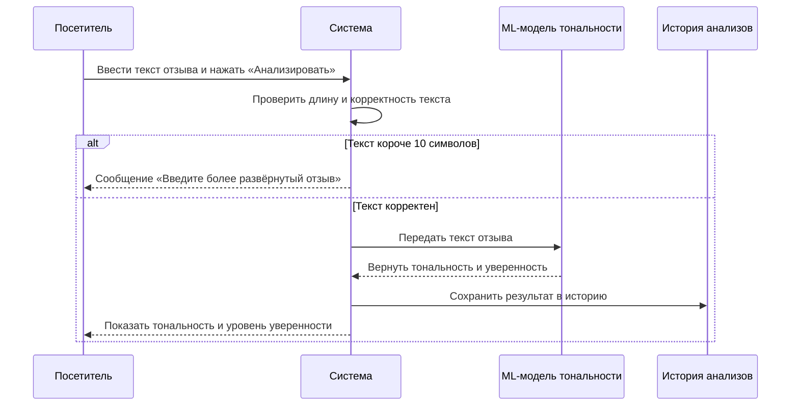
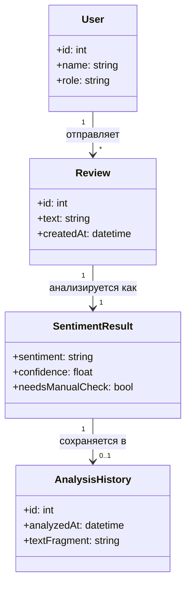

# Диаграммы

## Диаграмма последовательности

Диаграмма показывает взаимодействие посетителя, системы и ML-модели при выполнении Use Case «Анализ тональности отзыва» (UC-01).

## Диаграмма классов

Диаграмма описывает основные сущности сервиса: пользователь, отзыв, результат анализа и запись истории.

